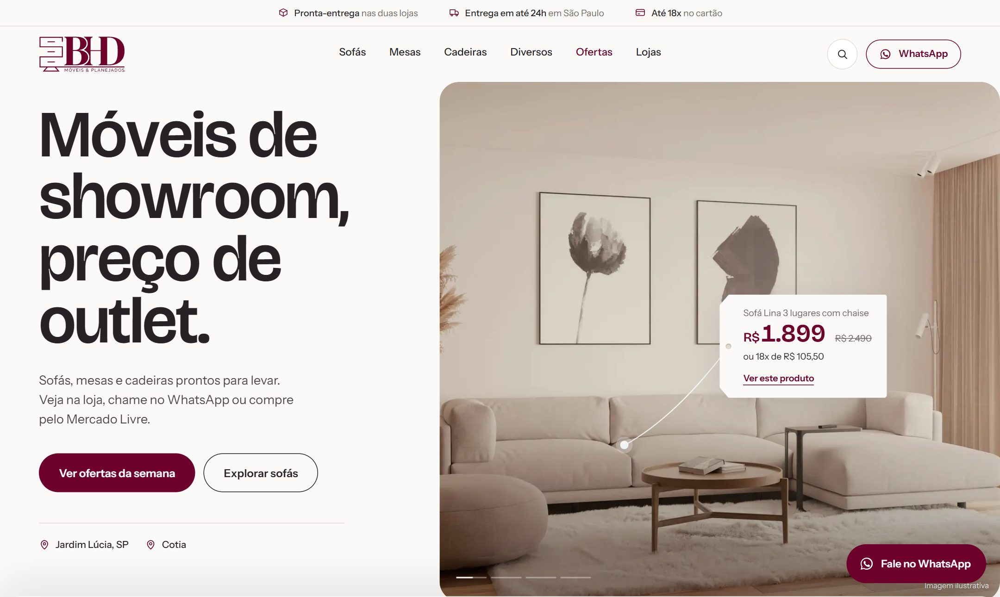

<p align="center">
  
</p>

<h1 align="center">BHD Móveis — site vitrine</h1>

<p align="center">
  Vitrine de móveis com preço de outlet e acabamento de alto nível.<br>
  Sem carrinho: a compra acontece na loja, pelo WhatsApp, no Mercado Livre ou na Amazon.
</p>

<p align="center">
  
  
  
  
  
  
  
  
</p>

<p align="center">
  <a href="https://alexandregarciajr.github.io/bhd-moveis-website/"><strong>Ver o preview →</strong></a>
</p>

<p align="center">
  
</p>

> **Versão de demonstração.** Produtos, preços e fotos são ilustrativos (imagens do Unsplash) e serão substituídos pelos dados reais da BHD. O preview não é indexado pelo Google.

---

## Sobre o projeto

A BHD Móveis é uma loja de móveis com posicionamento outlet, com unidades no Jardim Lúcia (São Paulo) e em Cotia. O site foi pensado para o público de massa: preço sempre visível, caminhos de compra claros e carregamento rápido, com a qualidade aparecendo na tipografia, na fotografia e nos detalhes de interação.

**Direção visual**
- Bordô da marca (`#6D012B`, medido no logo oficial) sobre base clara, com linho e grafite.
- Tipografia: Bricolage Grotesque (títulos e preços) e Instrument Sans (textos).
- Elemento de marca: a **etiqueta de loja** pendurada por um cordão, usada para mostrar os preços.

**Experiência**
- **Hero com cenas:** a cada poucos segundos um novo ambiente se abre em círculo a partir do ponto da etiqueta; a etiqueta antiga cai e a nova se pendura balançando.
- **Saída do hero:** ao rolar, as letras do título se desfazem, a foto encolhe numa janela e as categorias sobem por cima.
- **Ofertas da semana:** a página para e a rolagem empurra o carrossel para o lado (desktop).
- **Interações:** texto que rola nos links e botões, botões magnéticos, cursor contextual sobre as fotos, cards com troca de foto e etiqueta que balança.
- Tudo funciona sem animação para quem ativa "reduzir movimento" ou navega sem JavaScript.

**Comercial e técnico**
- Cada produto define o canal de compra principal (Mercado Livre, Amazon ou WhatsApp).
- Busca instantânea, ordenação e filtro de pronta-entrega nas categorias.
- Páginas de lojas com rota, WhatsApp e link para avaliar no Google.
- SEO técnico: títulos e descrições únicos, sitemap, dados estruturados das lojas e do FAQ.
- Medição preparada (Google Analytics, Meta Pixel, Microsoft Clarity), carregada só após consentimento de cookies (LGPD).

## Como funciona

Os dados ficam em arquivos JSON, os templates são PHP e o `build.php` gera um site **100% estático** em `dist/`. O PHP roda só na máquina de quem gera o site. A hospedagem recebe apenas HTML, CSS, JS e imagens, então funciona em qualquer lugar (HostGator, GitHub Pages, Netlify, Cloudflare Pages).

```
data/*.json  +  templates/*.php  ──►  php build.php  ──►  dist/  ──►  hospedagem
```

| Camada | Tecnologia |
|---|---|
| Dados | JSON (`data/`) |
| Templates e gerador | PHP 8 (`templates/`, `build.php`) |
| Estilo | CSS puro com tokens de design (`assets/css/`) |
| Interface | JavaScript puro (`assets/js/main.js`) |
| Animações | GSAP + ScrollTrigger + Flip (`assets/js/motion.js`) |
| Imagens | WebP em 3 tamanhos, gerado com sharp (`npm run imagens`) |

## Rodar localmente

Requisitos: PHP 8.1+ (para gerar o site) e Node.js 18+ (só para otimizar imagens).

```bash
npm install          # uma vez, instala o otimizador de imagens
npm run dev          # gera o site e abre em http://localhost:8080
```

Outros comandos:

```bash
npm run imagens            # converte as fotos de imagens-originais/ em WebP
php build.php              # gera o site em dist/ (preview, sem indexação)
php build.php --producao   # gera para o domínio final (indexável)
php build.php --base=nome  # gera para uma subpasta (ex.: GitHub Pages)
```

## Estrutura

```
data/               produtos, categorias, lojas e configurações (site.json)
templates/          layout, partes reutilizáveis (partials/) e páginas (paginas/)
assets/             css, js, fontes e imagens já otimizadas
tools/              otimizador de imagens
build.php           gerador do site
design/mockups/     JPEGs de aprovação
docs/               plano do projeto, PDF de aprovação e créditos das imagens
dist/               site gerado (fora do git)
imagens-originais/  fotos em alta (fora do git)
```

## Manutenção do dia a dia

**Adicionar um produto**
1. Crie a pasta `imagens-originais/produtos/<slug-do-produto>/` com as fotos `01.jpg`, `02.jpg`...
2. Rode `npm run imagens`.
3. Copie um produto em `data/produtos.json` e troque `id`, `slug`, `nome`, `categoria`, `preco` e os links.
4. Rode `php build.php` e confira.

**Mudar preço ou link:** edite o produto em `data/produtos.json` e atualize `atualizado_em`.

**Tirar um produto do ar:** `"ativo": false`. O produto some do site, da busca e do sitemap.

**Destaque e ofertas:** `"destaque": true` coloca o produto em "Mais procurados". Se ele tiver `preco_anterior` maior que `preco`, entra automaticamente em Ofertas.

**Nova categoria:** adicione em `data/categorias.json`, com `capa` apontando para a foto de um produto. Menu, rodapé e páginas são gerados sozinhos.

**Cenas do topo da home:** em `data/site.json` → `hero.cenas`. Cada cena tem o `produto` (slug), a `imagem`, o `foco` da foto, a posição da `ancora` (o ponto branco, em % da foto) e da `etiqueta`. O tempo de cada cena é `segundos_por_cena`.

**Lojas, WhatsApp e benefícios:** `data/unidades.json` e `data/site.json`.

**Ligar Analytics, Pixel e Clarity:** em `data/site.json` → `analytics`, preencha o `id` e mude `ativo` para `true`. O aviso de cookies aparece automaticamente.

**Mostrar a nota do Google:** `data/site.json` → `avaliacoes.exibir_nota` (deixe desligado enquanto houver poucas avaliações).

**Sair do modo demonstração:** `data/site.json` → `"demo": false`, quando os produtos e fotos reais entrarem.

## Publicar

**Preview (GitHub Pages):** a cada `git push` na branch `main`, o workflow [`.github/workflows/pages.yml`](.github/workflows/pages.yml) instala o PHP, gera o site para a subpasta do repositório e publica. O preview sai com `noindex`.

**Produção (HostGator):** rode `php build.php --producao` e envie **o conteúdo** de `dist/` (não a pasta) para o `public_html/`. Confira se o arquivo oculto `.htaccess` também subiu.

## Créditos

- Projeto e desenvolvimento: [Alexandre Garcia Jr.](https://github.com/AlexandreGarciaJr)
- Fotos ilustrativas: [Unsplash](https://unsplash.com) (lista em [`docs/CREDITOS-IMAGENS.txt`](docs/CREDITOS-IMAGENS.txt))
- Fontes: Bricolage Grotesque e Instrument Sans (SIL Open Font License), via Fontsource
- Animações: [GSAP](https://gsap.com)

A marca BHD Móveis e seu logotipo pertencem à BHD Móveis & Planejados.
